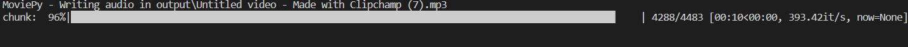

# Audio Extractor from Video

Extract audio from your favorite videos using a simple GUI.

## Details

This project uses the following Python modules:

- `os`
- `moviepy`
- `tkinter`

`tkinter` ships with the standard Python installer on Windows. Verify it with `python -c "import tkinter"`. Do not run `pip install tk`; that is not how this environment provides Tkinter.

The third-party package declared by this project is MoviePy:

```
pip install -r requirements.txt
```

MoviePy calls an FFmpeg executable to read the video and write the audio. Installing MoviePy also installs `imageio-ffmpeg`, which supplies that executable. This project does not call `pip install ffmpeg`, and a separate FFmpeg entry on `PATH` is not required when `imageio-ffmpeg` is installed.

## Features

- Dialog-based flow: a file picker, a format prompt, then a success or error message.
- The file picker filter lists `mp4`, `avi`, `mkv`, `flv`, and `mov`.
- Creates `input` and `output` directories when they are missing.
- The audio extension is the text entered in the format dialog. The initial value is `mp3`.

## Getting Started

1. Clone this repository: `git clone https://github.com/Bisalkumar/Audio-Extractor.git`
2. From the project directory, create a virtual environment and install dependencies:

```
python -m venv venv
venv\Scripts\python.exe -m pip install -r requirements.txt
```

3. Start the script:

```
venv\Scripts\python.exe extractor.py
```

## How to Use

1. On startup the hidden root window opens a file dialog titled **Select the video file**. Choose a video. The script has no main form and no "Select video file" button.
2. A folder dialog opens in the `output` folder. Choose where the video copy and the audio file should be saved, or keep that default folder.
3. A dialog titled **Output Format** asks for the audio extension. It starts as `mp3`. The prompt's examples are `mp3` and `wav`.
4. The script copies the selected video into the chosen folder, then writes the audio file in that same folder.
5. A success dialog shows the audio path inside the folder you selected.

## Screenshots



`Sample.png` is a console capture of MoviePy's audio-writing progress bar. It is not a picture of the file dialog.

## Contributions

We welcome contributions from the community. If you'd like to contribute:

1. Fork this repository.
2. Create a new branch for your feature or bugfix.
3. Push your changes and create a pull request.

## License

This project is licensed under the MIT License. See [LICENSE](LICENSE) file for details.

## Acknowledgement

- Thanks to the `moviepy` team for the amazing library.
- All contributors and users of this tool.

Original author: Bisal Kumar Sahoo, 2023. See [LICENSE](LICENSE).
