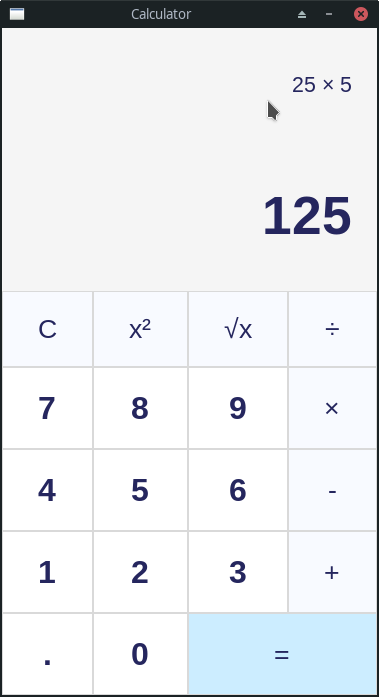

# Tkinter Calculator (Python)

Tiny and feature-rich calculator application created by Python powered by Tkinter. (GUI Calculator)

Original project: [BaseMax/TkinterCalculator](https://github.com/BaseMax/TkinterCalculator)

License: GNU GPL v3 — see `LICENSE`.



## Description

A single-file desktop calculator (`app.py`) built with the standard library Tkinter widget set (`Tk`, `Frame`, `Label`, `Button`). It supports digits, decimal point, add/subtract/multiply/divide, square, square root, clear, equals, and keyboard shortcuts for digits, operators, and Enter.

## Requirements

- Python 3 (verified with Python 3.12 on Windows 10)
- Tkinter bundled with Python (do **not** `pip install tkinter`)
- No `requirements.txt` and no extra runtime packages

## Installation

Clone or copy this folder. Optional virtual environment:

```bash
python -m venv .venv
```

On Windows PowerShell:

```powershell
.\.venv\Scripts\Activate.ps1
```

No `pip install` step is required to run the calculator.

## Running

From the project root (the folder that contains `app.py`):

```bash
$ python app.py
```

Arabic step-by-step lab notes: [RUN_GUIDE.md](RUN_GUIDE.md)

## Usage

- Number and `.` buttons (or keyboard) append to the current value.
- `+` `-` `×` `÷` move the current value into the running expression.
- `=` or Enter evaluates the expression with Python `eval`.
- `C` clears both displays.
- `x²` squares the current value; `√x` takes its square root.
- Close the window with the title-bar close button.

There is no Backspace key binding in this project.

## Testing

Manual checks used in the teaching setup:

- Startup: window title `Calculator`, size `375x667`
- `2+3=` → `5`
- `8÷2=` → `4.0`
- `5÷0=` → `Error`
- `9` then `√x` → `3.0`
- Keyboard `7` `8` → `78`
- Enter after `2+2` → `4`

Teaching maps: [TEACHING_GUIDE.md](TEACHING_GUIDE.md), [FILE_TEACHING_ORDER.md](FILE_TEACHING_ORDER.md), [PROJECT_MAP.md](PROJECT_MAP.md)

## Troubleshooting

- `No module named tkinter`: reinstall Python with Tcl/Tk enabled (Windows) or install the OS package that provides Tk (for example `python3-tk` on some Linux distributions).
- Window does not appear: run from a desktop session, not a headless environment; confirm you are in the project directory.
- `python` not found: install Python and enable PATH, or try `py app.py` on Windows.

## Install requirements

> The Tkinter library is built-in with every Python installation.

Read more: https://tkdocs.com/tutorial/install.html

## Standalone Executable

At first you need to install the **pyinstaller**: `$ pip install pyinstaller`

Next:
```bash
$ pyinstaller --onefile -w app.py
```

**Note:** this is python. so everyone can emit and reverse(like decompile) your program.

I get the idea from a [video](https://www.youtube.com/watch?v=QZPv1y2znZo).
