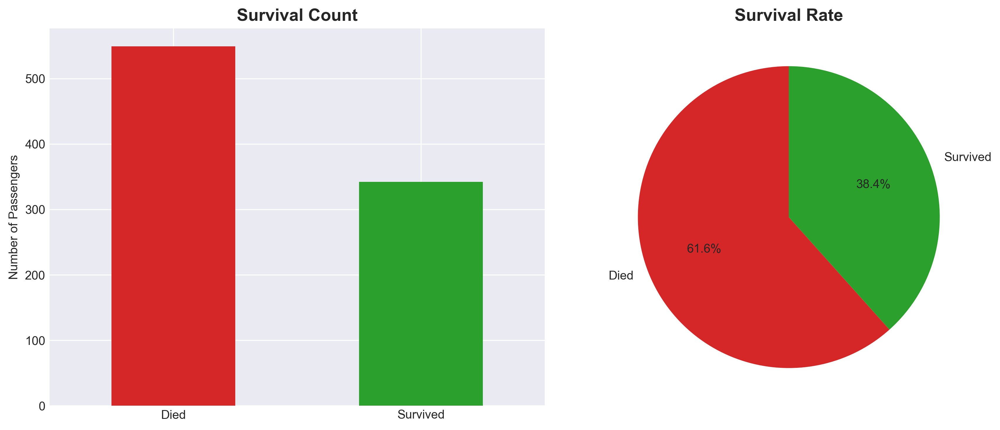
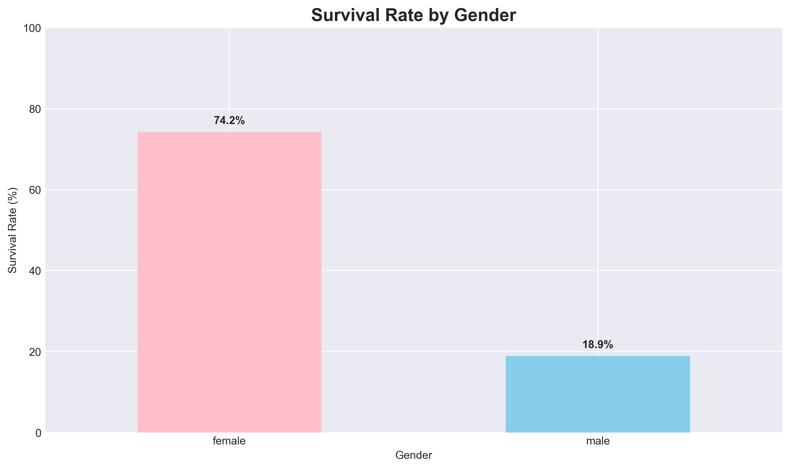
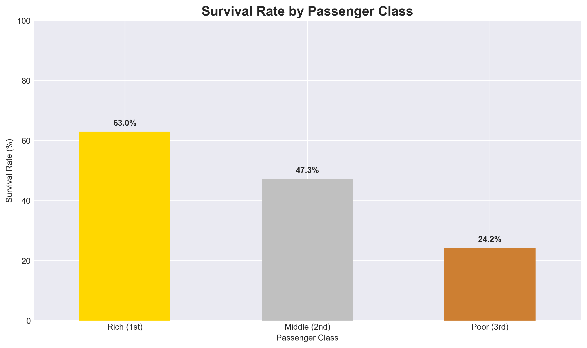
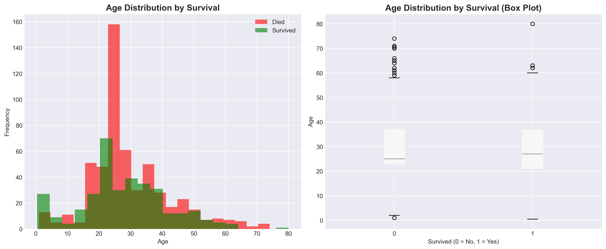
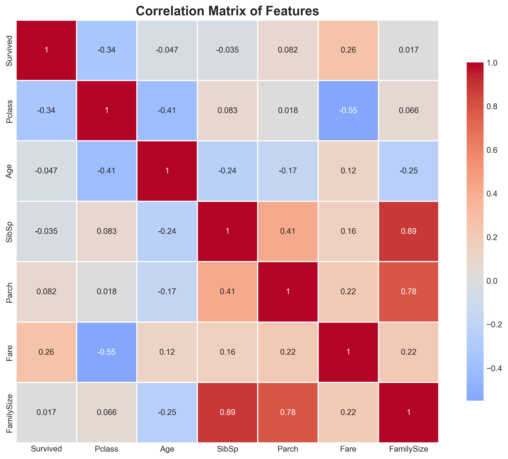
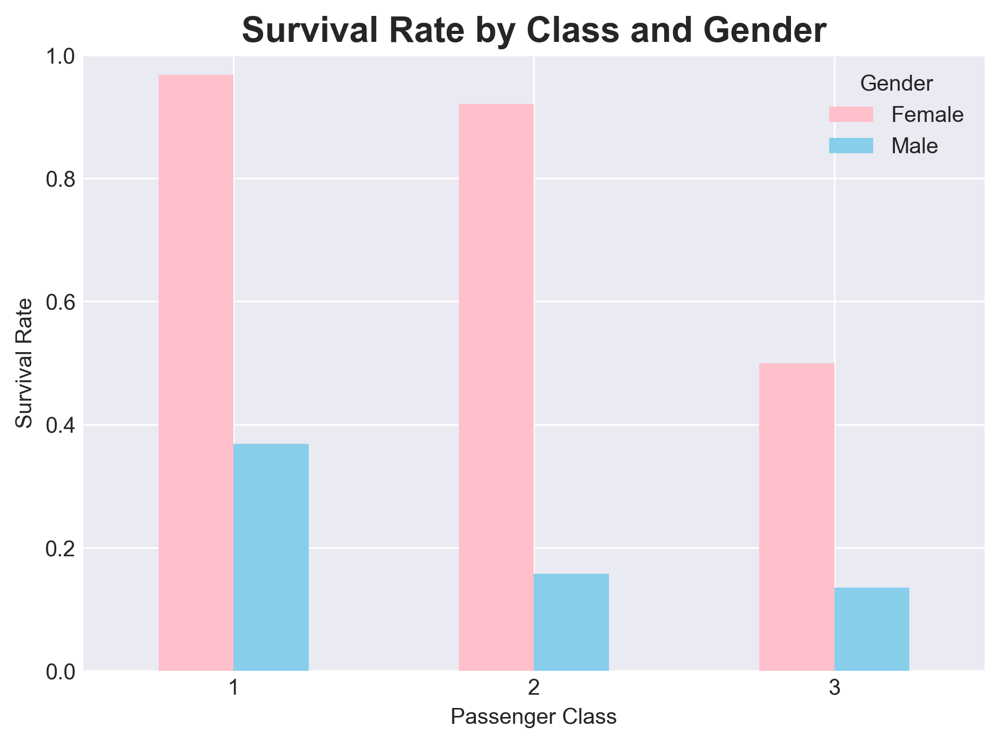
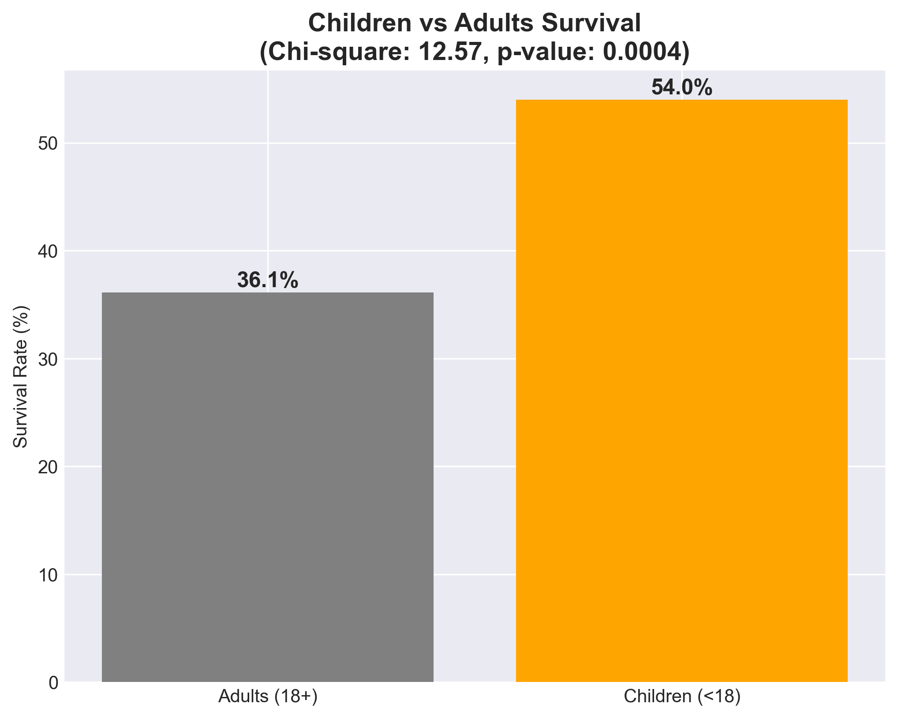

# 🚢 Titanic Survival Analysis

> A comprehensive statistical analysis of the Titanic disaster dataset to understand factors influencing passenger survival using Python, Pandas, and advanced data visualization techniques.

---

## 📊 Project Overview

This project analyzes the famous Titanic dataset from Kaggle to uncover survival patterns during the 1912 disaster. Using statistical methods and data visualization, we explore how factors like gender, class, age, and family composition influenced survival odds.

**Key Objectives:**
- Identify primary survival predictors through statistical testing
- Validate the "women and children first" maritime protocol
- Measure socioeconomic privilege impact on survival
- Demonstrate professional data analysis workflow

---

## 🔍 Key Findings

### 1. **Catastrophic Mortality Rate**
- **61.6% fatality rate** (549 deaths out of 891 passengers)
- Only 38.4% survived this maritime disaster

### 2. **Gender as Primary Survival Factor**
- **Women: 74.2% survival** vs **Men: 18.9% survival**
- Women were **4x more likely** to survive (χ² = 260.72, p < 0.001)
- Validates "women and children first" evacuation protocol

### 3. **Socioeconomic Class Disparity**
| Class | Survival Rate | Interpretation |
|-------|---------------|----------------|
| 1st | 63.0% | Wealthy passengers had privileged lifeboat access |
| 2nd | 47.3% | Middle class had moderate chances |
| 3rd | 24.2% | Poor passengers faced 61% lower survival than 1st class |

**Statistical significance:** χ² = 102.89, p < 0.001

### 4. **Age Distribution Patterns**
- **Children (0-15):** Higher survival in upper classes
- **Young Adults (20-50):** Moderate survival, gender-dependent
- **Seniors (65-80):** Lowest survival rates (~20-30%)
- Survivors were significantly younger (mean: 28.3 vs 30.6 years, p = 0.039)

### 5. **Wealth-Survival Gradient**
Using fare-per-person analysis (adjusted for family tickets):

| Fare Category | Survival Rate |
|---------------|---------------|
| Very High ($100+) | 81.8% |
| High ($50-100) | 68.2% |
| Medium ($20-50) | 55.6% |
| Low ($10-20) | 43.1% |
| Very Low (<$10) | 27.8% |

**Linear gradient:** Each tier shows ~12-15% survival increase (r = +0.26, p < 0.001)

### 6. **Gender × Class Intersection**
Critical finding: **Gender trumped class in evacuation priority**
- 1st class women: 96.8% survival
- 3rd class women: 50.0% survival
- 1st class men: 36.9% survival
- 3rd class men: 13.5% survival

**Paradox:** A 1st class man had **lower survival odds** than a 3rd class woman.

### 7. **Children vs Adults (Statistical Validation)**
- Children (<18): 54% survival
- Adults (18+): 36.1% survival
- χ² = 12.45, p = 0.0004 (statistically significant)

**Confounding factor:** Class mediated age effect — 3rd class children had poor survival despite "children first" policy.

---

## 📈 Visualizations

### Overall Survival Distribution

*Figure 1: Only 38.4% of passengers survived the disaster*

### Gender Impact

*Figure 2: Women had 74.2% survival rate vs 18.9% for men (4:1 ratio)*

### Class Disparity

*Figure 3: Clear socioeconomic gradient - 1st class (63%) vs 3rd class (24%)*

### Age Distribution

*Figure 4: Age comparison between survivors and non-survivors*

### Correlation Heatmap

*Figure 5: Pclass (-0.34) and Fare (+0.26) are strongest predictors*

### Gender × Class Interaction

*Figure 6: Gender trumped class - 3rd class women (50%) > 1st class men (37%)*

### Fare Per Person Analysis

*Figure 7: Linear wealth gradient - Very High ($100+) had 81.8% survival*

### Children vs Adults

*Figure 8: Statistical validation of age effect (χ² = 12.45, p = 0.0004)*

---

## 🛠️ Technologies Used

- **Python 3.8+**
- **Pandas** - Data manipulation and analysis
- **NumPy** - Numerical computing
- **Matplotlib** - Data visualization
- **Seaborn** - Statistical graphics
- **SciPy** - Statistical testing (chi-square, t-tests)
- **Jupyter Notebook** - Interactive analysis environment

---

## 📁 Dataset

**Source:** [Kaggle Titanic Competition](https://www.kaggle.com/competitions/titanic/data)

**Features:**
- PassengerId, Survived (target variable)
- Pclass, Name, Sex, Age
- SibSp (siblings/spouses), Parch (parents/children)
- Ticket, Fare, Cabin, Embarked

**Records:** 891 passengers (training set)

---

## 🚀 Getting Started

### Prerequisites
```bash
Python 3.8 or higher
pip package manager
```

### Installation

1. **Clone the repository**
```bash
git clone https://github.com/ShoafzalDataAnalyst/titanic-survival-analysis.git
cd titanic-survival-analysis
```

2. **Install dependencies**
```bash
pip install -r requirements.txt
```

3. **Run the Jupyter Notebook**
```bash
jupyter notebook Notebook/Titanic_analysis.ipynb
```

---

## 📝 Methodology

### 1. **Data Cleaning**
- Handled missing values (Age: median imputation by class, Embarked: mode imputation)
- Dropped Cabin column (77% missing data)
- Removed duplicates and outliers

### 2. **Feature Engineering**
- Created `FamilySize` = SibSp + Parch + 1
- Created `FarePerPerson` = Fare / FamilySize (accurate wealth measure)
- Created `AgeGroup` categories (Child, Teenager, Adult, Middle-aged, Senior)
- Created `IsChild` binary indicator (<18 years)

### 3. **Statistical Analysis**
- **Chi-square tests** for categorical variables (gender, class)
- **Independent t-tests** for continuous variables (age)
- **Correlation analysis** to identify multicollinearity
- **Significance threshold:** p < 0.05

### 4. **Visualization Strategy**
- Bar charts for categorical comparisons
- Histograms and box plots for distributions
- Heatmaps for correlation matrices
- Grouped visualizations for interaction effects

---

## 💡 Insights for Data Science Learners

### **1. Feature Engineering is Critical**
Raw data rarely tells the full story. Creating `FarePerPerson` revealed wealth patterns hidden in family ticket purchases.

### **2. Always Validate with Statistics**
Visual patterns must be confirmed with hypothesis testing. I used chi-square and t-tests to prove significance.

### **3. Beware of Confounding Variables**
Initial observation: "Children survived less than adults"  
Deeper analysis: "3rd class children had terrible survival; 1st class children had excellent survival"  
→ Class mediated the age effect!

### **4. Context Matters**
This wasn't random — it reflected 1912 social hierarchies (gender norms, class privilege, maritime law).

### **5. Data Tells Stories**
Structure findings as a narrative: overall tragedy → gender privilege → class privilege → their intersection.

---

## 📊 Project Structure

```
titanic-survival-analysis/
├── README.md                        # Project documentation
├── data/
│   ├── raw/train.csv                # Original Kaggle data
│   └── cleaned/titanic_cleaned.csv  # Preprocessed data
├── Notebook/
│   └── Titanic_analysis.ipynb       # Main analysis notebook
├── visuals/                         # All generated plots
├── requirements.txt                 # Python dependencies
└── .gitignore
```

---

## 📜 Requirements

```
pandas>=1.5.0
numpy>=1.23.0
matplotlib>=3.6.0
seaborn>=0.12.0
scipy>=1.9.0
jupyter>=1.0.0
```

---

## 🤝 Acknowledgments

- **Kaggle** for providing the Titanic dataset
- **Pandas Documentation** for comprehensive guides
- **Data Science Community** for best practices and inspiration

---

## 📧 Contact

**Shoafzal Shomuhidov**
- GitHub: [@ShoafzalDataAnalyst](https://github.com/ShoafzalDataAnalyst)
- LinkedIn: [shoafzal-shomuhidov](https://www.linkedin.com/in/shoafzal-shomuhidov-15b647389/)
- Email: shomuhidov.shoafzal@gmail.com

---

## ⭐ Star This Repository

If you found this analysis helpful, please consider giving it a star! ⭐

---

**Last Updated:** April 2026